# GA01 — Virtual Network Framework (VyOS · IS-IS · OpenDaylight · iBGP)

A four-router service-provider-style lab built in **GNS3** on a single 16 GB Windows PC. The four **VyOS** routers run **IS-IS** across five core links. An **OpenDaylight** controller on Ubuntu Server peers with R1 over **iBGP on TCP 1790**, using a separate management LAN. The lab was tested with a controlled link failure, and extended with traffic shaping, SNMP monitoring, a live Python dashboard and IS-IS traffic-engineering attributes.

> Built by **Lekgothe Ngoepe** for the CPUT *Network Systems 3 (NSS370S)* GA1 project, November 2026.
> Addressing uses the personal allocation code **S = 103**.

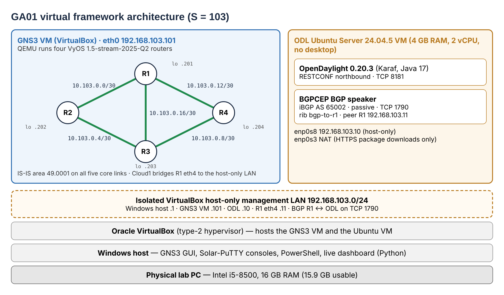

---

## Highlights

| | |
|---|---|
| Routing | IS-IS, one area (49.0001), point-to-point /30 links, passive loopbacks, ECMP |
| Controller | OpenDaylight 0.20.3 (Karaf, Java 17, BGPCEP), configured entirely through RESTCONF |
| BGP | iBGP AS 65002, R1 ↔ ODL on TCP 1790. ODL is passive and R1 opens the session. R1's loopback is verified in ODL's Loc-RIB |
| Resilience | R1–R2 link failed on purpose. Traffic rerouted via R3 and BGP stayed up throughout |
| Extras | 10 Mbit/s shaper + UDP ramp test, SNMPv2c, live topology dashboard, IS-IS TE TLVs |

## Platform

- **Host:** Windows, GNS3 GUI and Oracle VirtualBox.
- **GNS3 VM:** QEMU running four VyOS **1.5-stream-2025-Q2** routers (FRR 9.1.3).
- **Controller:** Ubuntu Server 24.04.5 VM (4 GB RAM, 2 vCPU) running OpenDaylight 0.20.3.
  - enp0s8: host-only, `192.168.103.10/24`
  - enp0s3: NAT, used only for package downloads
- **Management LAN:** VirtualBox host-only network `192.168.103.0/24`. R1 eth4 joins it through a GNS3 Cloud node.

## Topology and addressing

The four routers form a ring (R1–R2–R3–R4) plus a diagonal R1–R3, so every router has at least two paths.

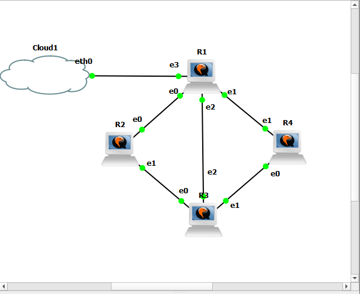

| Link | Subnet | Side A | Side B |
|---|---|---|---|
| R1–R2 | 10.103.0.0/30 | R1 eth5 .1 | R2 eth5 .2 |
| R2–R3 | 10.103.0.4/30 | R2 eth7 .5 | R3 eth7 .6 |
| R3–R4 | 10.103.0.8/30 | R3 eth5 .9 | R4 eth7 .10 |
| R1–R4 | 10.103.0.12/30 | R1 eth6 .13 | R4 eth5 .14 |
| R1–R3 | 10.103.0.16/30 | R1 eth7 .17 | R3 eth6 .18 |
| Loopbacks | /32 | R1 10.103.0.201 · R2 .202 | R3 .203 · R4 .204 |
| Management | 192.168.103.0/24 | Host .1 · GNS3 VM .101 | ODL .10 · R1 eth4 .11 |

> **Why eth4–eth7 and not eth0–eth3?** VyOS ties each interface name to a MAC address (`hw-id`). The routers were reused from an earlier project, so GNS3 ports e0–e3 appear as eth4–eth7, and not in port order. The last byte of each MAC gives the real GNS3 port number. Checking this mapping is what fixed the project's biggest fault (see [docs/troubleshooting.md](docs/troubleshooting.md)).

## Repository layout

```
configs/vyos/          R1–R4 configuration commands, Feature A shaper, Feature D vtysh block
configs/opendaylight/  RESTCONF XML (BGP instance, peer acceptor, R1 neighbour) + apply.sh
dashboard/             ga01_dashboard.py — live SNMP + RESTCONF topology dashboard
docs/                  troubleshooting log
images/                screenshots from the running lab
```

## Results

### Routing

On R1, all three IS-IS neighbours are Up. The other loopbacks are learned as `I>*` routes at metric 20. Loopback-sourced pings to every router have 0% loss.

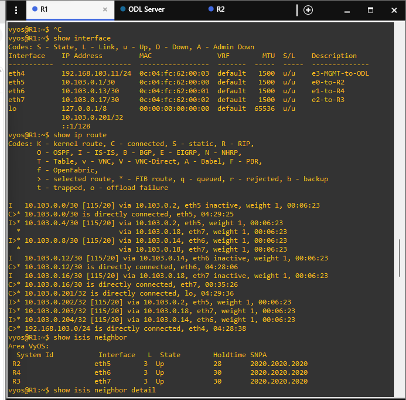

### OpenDaylight ↔ R1 BGP

All three RESTCONF PUTs returned **HTTP 201**. R1 shows **Established** with PfxSnt 1, and the session was seen up for 2 h 40 min. The hold time is 90 s: R1 is set to 180 and ODL to 90, and BGP uses the lower value. ODL's Loc-RIB contains `10.103.0.201/32` with next hop `192.168.103.11`.

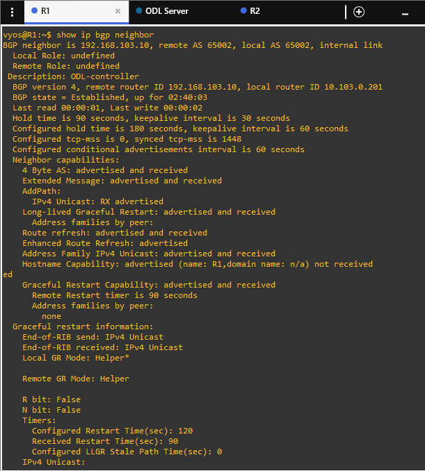
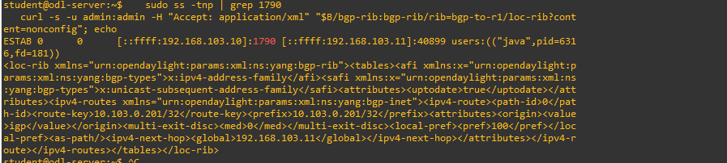

### Controlled link failure (R1 eth5, the R1–R2 link, disabled)

| Check | Predicted | Observed |
|---|---|---|
| R1 → 10.103.0.202 | Moves from eth5 (metric 20, 1 hop) to via R3 (metric 30, 2 hops) | via 10.103.0.18 eth7, metric 30 ✔ |
| R2 outage | Up to about 30 s (IS-IS hold time) | **28 of 86** pings lost (≈ 28 s), TTL 64 → 63 ✔ |
| BGP to ODL | Stays up (it runs on the management LAN) | Still Established ✔ |
| After restore | Back to eth5, metric 20 | 84/84 pings, 0% loss ✔ |

R2 only rerouted after its hold timer expired. In GNS3, disabling R1's side does not drop R2's side of the link. Lower hello timers or BFD would shorten the outage.

| Before / during | R2 continuous ping | Restored |
|---|---|---|
| 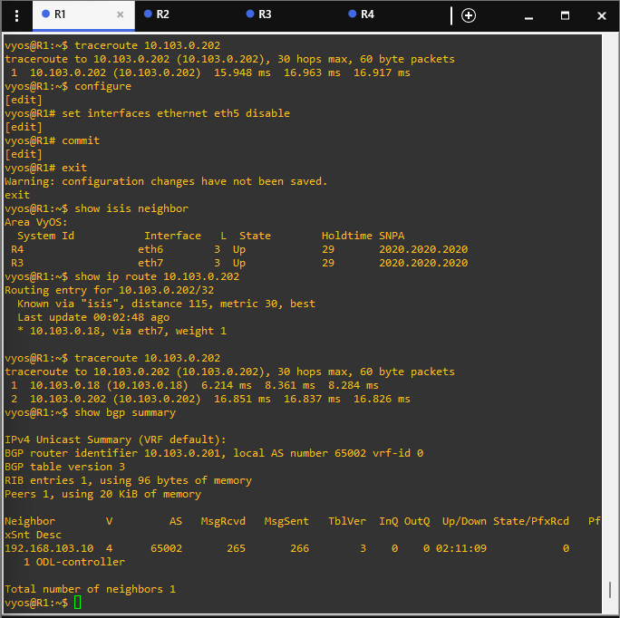 | 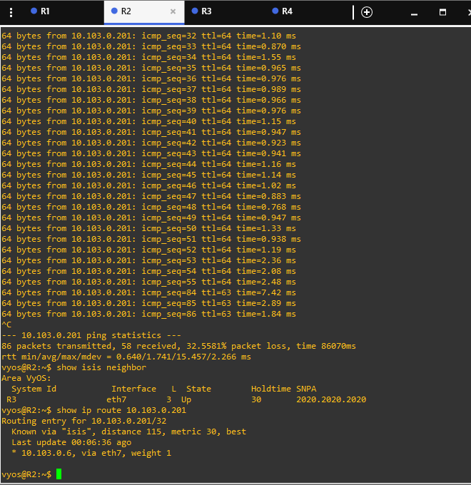 | 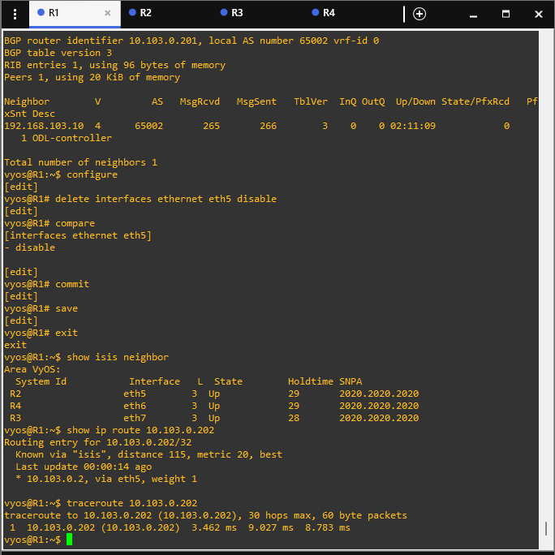 |

## Advanced features

| Feature | Result |
|---|---|
| **A. UDP ramp + shaper** | 10 Mbit/s shaper `GA01-LIMIT` on R1 eth5 egress, with iperf3 UDP from R1 to R2. Loss was 0% at 2 and 5 Mbit/s, under 0.1% at 8, about 9% at 10, and 24% at 12. The bottleneck is about **9.1 Mbit/s** |
| **B. SNMP** | SNMPv2c read-only community `ga01ro`, restricted to the management subnet, on all four routers |
| **C. Live dashboard** | [`dashboard/ga01_dashboard.py`](dashboard/ga01_dashboard.py), pure standard-library Python. It polls IF-MIB on all routers and the BGP state from ODL's Loc-RIB. A link counts as up only if both ends are up **and** frames arrived in the last 8 s, so a GNS3 link *Suspend* turns red |
| **D. IS-IS TE** | Wide metrics and TE on all routers, plus `link-params` (max-bw / max-rsv-bw) on R1 eth5. R2 sees the new bandwidth TLVs in R1's LSP |
| **E. BGP-LS** | Not possible: VyOS 1.5-stream-2025-Q2 offers no link-state address family (documented) |

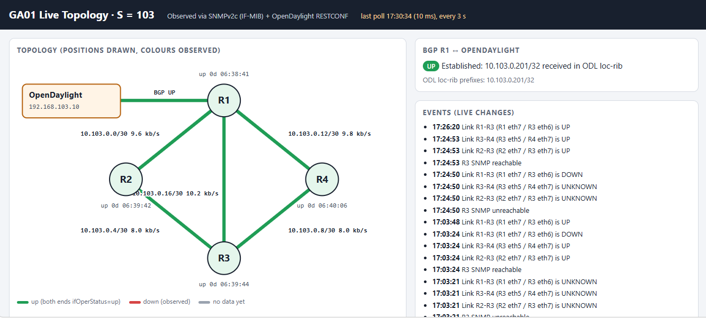
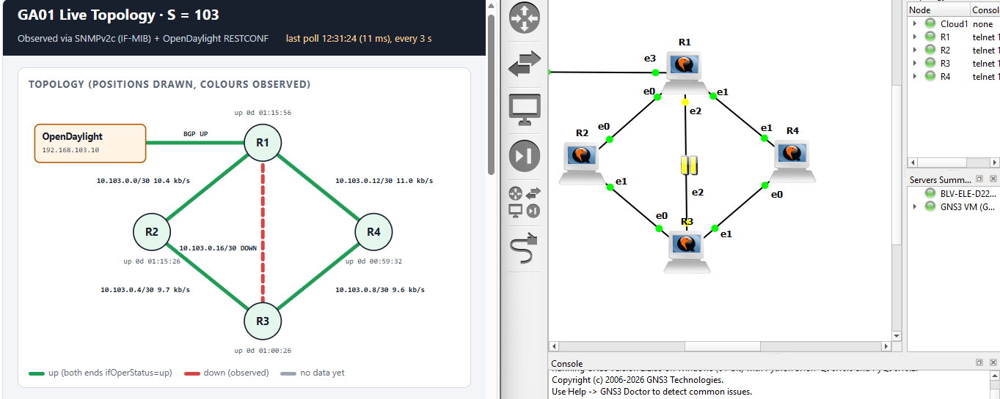

| Feature A: receiver loss | Feature D: TE TLVs on R2 | Feature E: no link-state AF |
|---|---|---|
| 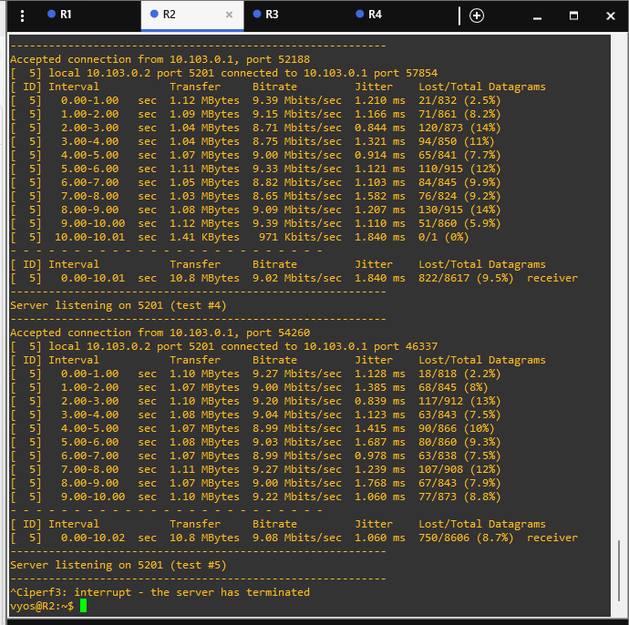 | 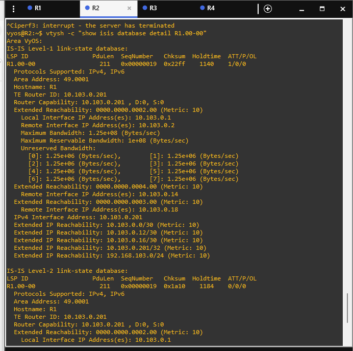 | 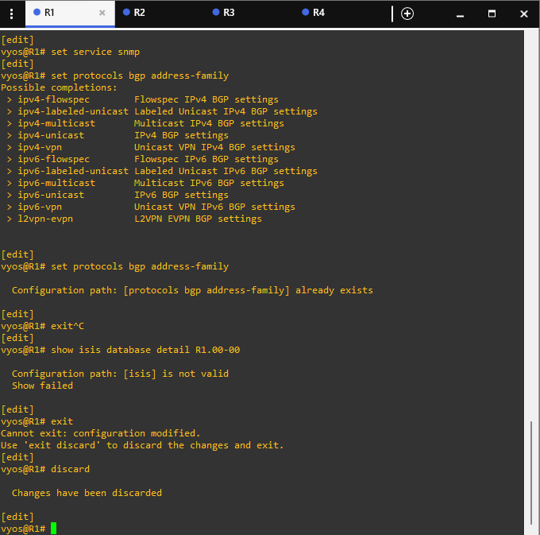 |

## Reproduce

1. **Routers:** on each router, run `configure`, paste `configs/vyos/Rx.conf`, then `compare`, `commit` and `save`. Check with `show isis neighbor`, `show ip route isis` and `ping 10.103.0.203 source-address 10.103.0.201`.
2. **Controller:** on the Ubuntu Server:
   ```bash
   cd ~/opendaylight-0.20.3 && ./bin/karaf
   # in Karaf:
   feature:install odl-restconf odl-bgpcep-bgp
   # in a second shell:
   cd configs/opendaylight && ./apply.sh
   ```
3. **BGP:** on R1, run `show bgp summary`. If the state is `Active` because ODL was still starting, run `reset bgp 192.168.103.10`.
4. **Dashboard:**
   ```bash
   # The host needs a route to the router loopbacks via R1, for example on Windows (admin):
   route add 10.103.0.0 mask 255.255.255.0 192.168.103.11
   python dashboard/ga01_dashboard.py --once   # single test poll
   python dashboard/ga01_dashboard.py          # then open http://localhost:8090
   ```

## Lessons learned

- On point-to-point links IS-IS can show a neighbour **Up** even when the two ends are in different subnets. Always check the adjacency, the route table and a ping together.
- Keep the controller on a separate management LAN: the core failure test never touched the BGP session.
- Ubuntu Desktop was too heavy for a 16 GB host running the whole lab. Ubuntu Server boots in about a minute and uses about 5% of its 4 GB.
- The campus network blocked plain HTTP, so apt mirrors and the ODL download were switched to HTTPS.

## Tools

GNS3 · VirtualBox · VyOS 1.5 · FRR · OpenDaylight 0.20.3 (BGPCEP, RESTCONF) · Ubuntu Server 24.04 · iperf3 · Wireshark · Python 3
